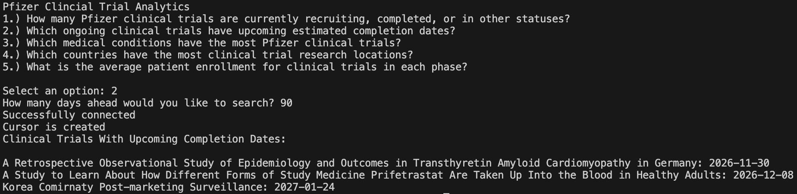

# Pfizer Clinical Trial Monitoring ETL Pipeline 

## Problem
How can a pharmaceutical company efficiently monitor hundreds of clinical trials without manually reviewing individual records?


## Solution
Built a Python ETL pipeline that extracts publicly reported Pfizer clinical trials from ClinicalTrials.gov, cleans and validates the data, and stores it in PostgreSQL for analysis.

A command-line interface allows users to answer five business questions:

1. How many trials are recruiting, completed, or in other statuses?
2. Which ongoing trials have upcoming estimated completion dates?
3. Which medical conditions have the most clinical trials?
4. Which countries have the most clinical trial research locations?
5. What is the average patient enrollment for each trial phase?

## Business Value
Efficiency: Reduces manual data collection and organization.

Monitoring: Helps identify trial progress and upcoming milestones.

Decision-making: Provides insights into research activity, enrollment, and geographic distribution.


## Tech Stack

- **Python** — ETL pipeline and command-line interface
- **Requests** — Extract data from ClinicalTrials.gov API
- **Pandas** — Clean, validate, and transform data
- **PostgreSQL** — Store clinical trial data in relational tables
- **Psycopg 3** — Connect Python to PostgreSQL
- **SQL** — Analyze clinical trial data

## ETL Architecture

**ClinicalTrials.gov API → Extract → Transform → Load → PostgreSQL → Analytics CLI**

- **Extract (`extract.py`):** Retrieves Pfizer clinical trials using API pagination.
- **Transform (`transform.py`):** Cleans data, validates dates, removes duplicates, and organizes records into four DataFrames.
- **Load (`load.py`):** Inserts new trials, updates changed records, and refreshes related tables in PostgreSQL.
- **Analytics (`analytics.py`):** Allows users to answer five analytical questions through a terminal interface.

## Database Schema

Clinical trial data is stored in four related PostgreSQL tables:

| Table | Description |
|---|---|
| `clinical_trials` | Stores trial IDs, titles, statuses, dates, enrollment, and sponsor information. |
| `trial_phases` | Stores the development phases associated with each trial. |
| `trial_conditions` | Stores the medical conditions being studied. |
| `trial_locations` | Stores research facilities and their geographic locations. |

The tables are connected through `nct_id`, which is the primary key in `clinical_trials` and a foreign key in the other three tables.

## Analytics CLI

The project includes an interactive command-line interface that runs SQL queries against the PostgreSQL database.

Users can answer five questions:

1. How many clinical trials are in each status?
2. Which ongoing trials have upcoming estimated completion dates?
3. Which medical conditions have the most clinical trials?
4. Which countries have the most research locations?
5. What is the average patient enrollment for each trial phase?

Users can select an option and enter additional parameters, such as the number of days or results to display.



## Installation & Usage

**Prerequisites:** Python 3.13 and PostgreSQL.

**1. Clone the repository and enter the project directory.**

**2. Create a virtual environment and install dependencies.**

```bash
python3 -m venv .venv
source .venv/bin/activate
pip install -r requirements.txt
```

**3. Create the PostgreSQL database and tables.**

```bash
createdb pfizer_clinical_trials
psql -d pfizer_clinical_trials -f src/sql/schema.sql
```

**4. Run the ETL pipeline.**

```bash
python src/pipeline.py
```

**5. Launch the analytics CLI.**

```bash
python src/analytics.py
```
